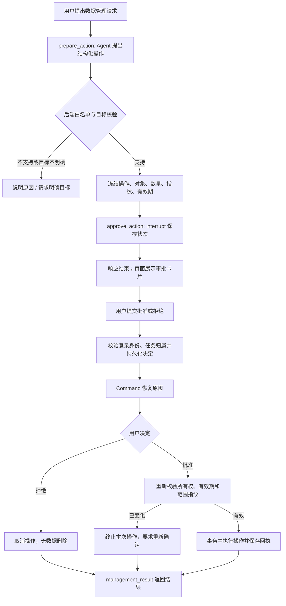

# Agent 敏感操作审批

登录后的单 Agent、多 Agent 文本对话现在支持人工审批。Agent 负责提出操作；后端按白名单决定可执行范围，冻结目标和影响范围。LangGraph `interrupt()` 将任务停在审批节点，PostgreSQL Checkpointer 保存状态；响应结束后释放连接和会话锁。用户点击批准或拒绝，后端记录决定，再用 `Command(resume=...)` 继续同一任务。



## 当前支持范围

| 操作 | 执行影响 | 限制 |
| --- | --- | --- |
| 删除本人指定旧会话 | 删除原始聊天、短期摘要、两种模式的图快照，以及以被删消息为来源的卡片和历史记忆片段 | 只能删除当前登录用户的会话；不能删除正在承载本次审批的会话 |
| 清空本人长期记忆 | 清空本人全部偏好/事实卡片、历史 RAG；设置遗忘水位，阻止旧消息重新回填 | 原始聊天、短期摘要和图快照仍保留；它们可能仍携带旧信息 |

不开放删除整个数据库、任意 SQL 或操作其他用户数据的工具。新增敏感能力需要同时增加结构化 schema、后端策略、权限校验、范围快照、事务执行和测试，不能仅修改提示词。

这套流程保护 **Agent 发起的操作**。页面已有的手动删除会话和记忆管理 REST 接口保留现有确认与所有权校验，不会再次创建 Agent 审批单。图片对话走视觉路径，没有这套图审批流程。

## 如何使用

1. 登录，在新会话中输入“删除会话 ID 为 XXX 的旧聊天记录”，或“清空我的长期记忆”。目标不明确时系统会要求说明。
2. 页面显示操作名称、对象标题与 ID、影响数量、保留/删除范围及有效期。数据此时尚未删除。
3. 点击“批准执行”或“拒绝并取消”。普通聊天中的“同意”不会被当作审批决定。审批期间不能继续在这个会话发送新问题，可以切换到其他会话。
4. 刷新页面后，从左侧“待处理”会话打开审批卡片。若决定已经保存但流程暂时失败，按钮用于继续相同决定，不允许改成相反决定。

默认审批有效期 900 秒。过期的审批不能批准，但可以拒绝。审批等待期间目标消息、记忆或清空水位范围变化，即使点击批准也不会执行删除，须重新提出操作。执行清空时使用审批时冻结的遗忘水位；其他会话在校验之后才保存的新消息也不会被这次审批纳入遗忘范围。

清空长期记忆不等于“模型再也看不到以前的信息”：原始聊天、摘要、检查点仍在；需要同时丢弃这些背景时，应另行删除指定旧会话或清除其图状态。管理请求的完成轮次会保存到聊天，但跳过自动长期记忆提取，避免清空后马上重新记住管理请求里的旧信息。

## 启用与接口

升级依赖、迁移并重启后端：

```powershell
cd backend
.\.venv\Scripts\python.exe -m pip install -r requirements.txt
.\.venv\Scripts\python.exe -m alembic upgrade head
```

`0019_agent_approvals` 新建审批审计表，依赖 `0018_agent_checkpoints`。默认 `CHECKPOINT_ENABLED=true`、`AGENT_APPROVAL_TTL_SECONDS=900`；无需新增模型 Key。匿名用户或关闭 Checkpointer 时不执行这些操作。本次未修改本地 `.env`，示例配置在 `backend/.env.example`。

| 接口 | 用途 |
| --- | --- |
| `POST /api/v1/chat` | 管理请求暂停时，`data.status=waiting_approval`，附带 `data.approval` |
| `POST /api/v1/chat/stream` | 发送 `type=approval` 事件后结束响应；暂停不是完成，不发送 `done` |
| `GET /api/v1/chat/conversations/{id}/approvals` | 当前登录用户该会话尚未完成任务的审批信息；可选 `mode=single/multi` |
| `POST /api/v1/chat/conversations/{id}/approval?mode=single` | 提交明确决定，恢复并返回最终结果；多模式传 `mode=multi` |
| `POST /api/v1/chat/conversations/{id}/resume?mode=single` | 未批准时仍返回等待；已保存决定时可续跑，不产生新的许可 |
| `DELETE /api/v1/chat/conversations/{id}/checkpoint?mode=single` | 放弃该模式图状态，取消其未执行审批 |

审批 POST 请求体只接受：

```json
{"approval_id": "服务端返回的32位审批ID", "approved": true}
```

拒绝传 `false`。仅接受真正的 JSON 布尔值；附加目标、操作参数等字段会被拒绝。所有普通响应继续使用 `{code,message,data}`。前端 HTTP 模块已解包 `data`。

## 状态与恢复保证

- 审批单绑定 `user_id + thread_id + run_id + mode`；操作和目标由服务端保存，客户端只能决定批准/拒绝。批准后执行时再次验证归属及目标快照。
- `approve_action` 是独立节点，只读取已冻结的操作，再调用 `interrupt()`。恢复会重进该节点，不能在 interrupt 前重新调用模型、生成新目标或执行删除。
- 数据删除与 `executed` 回执在同一 PostgreSQL 事务提交。批量操作任何一步失败都会回滚；模型不参与完成结果的编造。相交操作的回执记录各步骤实际删除数量。
- 执行提交后若检查点写入失败，恢复读已保存回执，不再次删除。新的同 ID 会话不会被旧任务重删。重复批准/拒绝不重复保存聊天，也不能更改已决定的结果。
- 会话并发锁、记忆更新锁及行锁保护应用内并发。目标正在执行任务时批准返回 409，可稍后重试同一决定；拒绝和回执重放不需要占用目标锁。
- `pending → approved → executed/failed` 或 `pending → rejected`；清除检查点/删除承载会话会将未执行审批标记为 `cancelled`。审计保留，删除用户时级联删除；尚未实现审计自动裁剪或管理端审计查询页面。

任务暂停期间不会保存“已完成”的聊天回答，也不会生成卡片或索引这一轮；恢复到最终结果后才保存完整轮次。领域 Agent 的 Python ReAct 循环未改成可中断子图；敏感管理请求走独占管理分支，不与专业领域并行执行。

## 阅读代码

| 文件 | 作用 |
| --- | --- |
| `backend/app/services/approval_service.py` | 规则、结构化提案、范围快照、interrupt、批准/拒绝、事务执行与回执 |
| `backend/app/schemas/agent_approval.py` | Agent 提案与用户决定的输入约束 |
| `backend/app/models/agent_approval.py` / `backend/alembic/versions/0019_agent_approvals.py` | 审批审计数据与迁移 |
| `backend/app/services/agent.py` / `multi_agent.py` | 单/多图的敏感管理分支 |
| `backend/app/services/checkpoint_service.py` | 原图恢复、等待状态、取消审批、幂等完成标记 |
| `backend/app/routers/chat.py` | 审批 API、SSE 事件和最终轮次保存 |
| `frontend-user/src/pages/Chat.vue` / `src/api/chat.js` | 审批卡片、按钮、刷新找回与恢复请求 |
| `backend/tests/api/test_agent_approvals.py` | 真实 PostgreSQL 与 LangGraph 中断回归，模型提案使用替身 |
| `backend/app/scripts/verify_agent_approval.py` | 真实配置模型 + API + PostgreSQL 的合成账号验收 |

验证结果见 [AGENT_APPROVAL_VALIDATION_2026-10-11.md](AGENT_APPROVAL_VALIDATION_2026-10-11.md)。LangGraph 中断及恢复语义见 [官方文档](https://docs.langchain.com/oss/python/langgraph/interrupts)。
