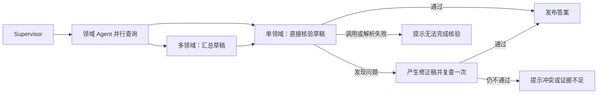

# 多智能体回答核验

多智能体现在先产生草稿，再用原始工具证据核验后发布。编排在 `backend/app/services/multi_agent.py`，核验规则、输出结构和证据预算在 `backend/app/services/answer_verification.py`。



无领域的通用闲聊保持原流程。`AGENT_MODE=single` 的单智能体不接入本次验证；多智能体只命中一个专业领域时仍须核验，只是跳过汇总。

## 核验依据

每次真实工具调用保留工具名称、参数与返回文本，放入本次请求的 `domain_evidence`。并行分支按领域合并；工具之后模型失败也保留此前证据。工具错误文本同样交给验证员，不能因为调用返回了字符串就当作查询成功。领域内部消息仍各自独立，原始工具结果只新增传给最终验证节点，并未实现领域之间直接交接或共享推理。

RAG 工具现保留完整已纳入分块，不再只给前 200 字；JSON 工具输出整体限制 6000 字符，超预算省略完整低排名分块，并带 `context_incomplete` 和省略数量。核验不得据此断言原文缺少信息或猜测上传/索引失败。纯 MCP 文本块先解包，避免字符串转义扩张后再次裁断；完整边界与真实块尾事实验收见 [RAG_TOOL_CONTEXT.md](RAG_TOOL_CONTEXT.md)。

验证员另起一次 LLM 调用，读取本次问题、上海当前日期时间、最近历史、记忆背景、领域答复、工具证据和草稿。历史助手文字与领域结论不能替代工具证据。数据作为 JSON 传入，系统提示明确禁止执行数据中的指令；这降低提示注入风险，不能保证模型绝不受影响。

主要检查：问题是否覆盖，地点/日期/预算/附近/室内等要求是否满足，用户已提供的信息是否被误称未知，数字和单位是否与证据一致，今天与明天是否混用，以及缺失、失败、过期搜索结果是否被误当成确定结论。

特别说明现有工具语义：`recommend_outfit` 和路线工具的内置天气针对今天；明日建议须使用对应日期预报。路线返回的驾车成本包含公里成本估算与可能的路费，不能当作实际出租车或网约车报价。验证会修正表达，但没有改变上游工具的数据接口或费用算法。

## 有限修正与发布

核验 JSON 必须包含 `passed`、`issues` 和 `revised_answer`。Pydantic 校验真假值与字段一致性：通过时不能同时列问题或替换答案；不通过时必须列具体问题和非空修正稿。首次通过即发布原草稿；首次不通过生成修正稿，再独立调用一次核验；第二次不通过不发布修正稿。调用或解析异常也不发布原稿。

第二轮保留问题、历史、记忆和原始工具证据，只核对修正后的 draft，不再附上已被修正的领域原稿，减少旧错误干扰复查。

`chat_multi()` 和完整图返回 `verification`，包括 `status`、`checks` 和 `issues`：

| 状态 | 含义 |
| --- | --- |
| `passed` | 模型首次判断草稿通过 |
| `corrected` | 模型发现问题，修正稿复查通过 |
| `unverified` | 模型调用或 JSON 解析/结构校验失败 |
| `failed` | 两次核验均未通过 |

这个状态目前供服务层、对照脚本和测试使用，普通聊天 HTTP 响应仍保持原有字段。最终回答才进入聊天历史和后续记忆处理；原始工具证据、草稿和核验详情不新增数据库持久化。

SSE 有专业领域时，等待验证节点结束，再发一条包含完整答案的 `token` 事件和 `done`。草稿、核验 JSON、未通过的修正稿都不会先显示给用户。代价是首段答案等待更久，专业领域回答不再边生成边展示。闲聊继续逐 token 推送。

每份答案额外产生 1 次核验 LLM 调用；修正时共 2 次，包含在图调用次数与 token 统计中。复用配置的默认模型（当前 DeepSeek），不需要新增 Key。

## 边界

这是同一基础模型的独立核验调用，不是独立外部事实认证。它能发现不少证据矛盾，但仍可能漏检、误判或产生过于保守的拒答；`passed` 不能等同于客观正确或任务全部完成。不会自动派回 Agent 补查、联网核实每个事实、重新规划，也不能查出原始数据源本身的全部错误。路由没有命中专业领域时不经过验证。

为限制上下文与成本，每条工具结果保留 6000 字符、参数 2000 字符，工具证据总预算约 30000 字符；有截断/省略标记。问题、历史、记忆、领域答复、草稿另有预算与截断标记；被省略的内容不能提供事实依据。长资料需要更精细的分块验证，当前并不完整审计所有历史和知识库。

## 验证入口

编排回归：backend 中运行：

```powershell
python -m pytest tests/unit/test_answer_verification.py tests/unit/test_multi_agent.py tests/unit/test_compare_agents.py --no-db -o addopts= -q
```

包含真实 LangGraph 单/多领域运行、并行证据合并、一次修正复查、模型/解析异常、步数限制、汇总故障、工具后模型故障、证据预算和 SSE 不泄漏草稿。模型和工具使用替身，不能代替模型能力验收。

真实验收：backend 中 `python -m app.scripts.verify_multi_agent`。使用实际配置的付费模型；4 个合成证据样例核对正确草稿、日期冲突、费用误用和无依据细节，另发普通天气穿搭及 SSE 路线真实请求。匿名请求不保存聊天或创建账号；不修改 `.env`。日志和报告脱敏，已有输出拒绝覆盖，可以 `--output ../docs/新的记录.json` 指定新文件。

`--http-only` 可只复测真实普通/SSE 链路。脚本退出码还要求全部答案通过模型核验；按设计阻止未通过的答案时，会保存 `failed` 记录并返回非零，不能把这种结果伪装成成功验收。

报告见 [真实验收记录](AGENT_VERIFICATION_LIVE_2026-10-10.md)。原始错误和首次漏检均保留，不把调用成功或模型判通过计作所有事实准确。
