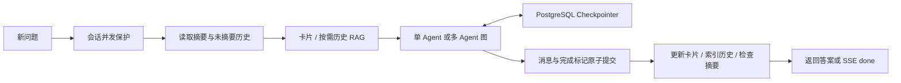

# Checkpointer 与双层长期记忆

登录文字对话在单 Agent、多 Agent 和 SSE 路径中启用 PostgreSQL checkpointer，与偏好/事实卡片、历史 RAG 同时工作。原始聊天和滚动摘要继续保留，不需要新增模型 Key。

| 模块 | 保存内容 | 使用范围 |
| --- | --- | --- |
| `chat_messages` / `chat_summaries` | 原始提问、最终回答、滚动摘要和覆盖水位 | 本会话短期上下文 |
| JSON 卡片 | 有用户原话证据的偏好与事实 | 同一用户跨会话，每轮有限注入 |
| 历史 RAG | 历史消息分块、1024 维向量 | 按需 BM25 + pgvector → RRF → reranker |
| Checkpointer | 图状态版本、节点结果、待完成任务 | 当前用户、会话、Agent 模式的工作流恢复 |



Checkpointer 保存的是图状态，字段可以包含聊天消息，但不会自动把整个聊天库塞进模型上下文。每个新任务仍读取摘要服务和记忆服务提供的有限背景。`Overwrite` 替换单 Agent 消息列表、多 Agent 领域答案/证据/累计指标，其他字段也赋初值，避免重复历史、旧工具消息和旧领域结果污染本轮。过去步骤保留在快照库。

## 实现

官方 `langgraph-checkpoint-postgres==3.1.2` 的 `PostgresSaver` 负责 SQL、序列化、版本和 pending writes。`checkpoint_service.py` 用 `asyncio.to_thread` 适配官方同步 saver 的异步方法，兼容 Windows 默认 Proactor 事件循环，无需改启动命令。每个请求独立打开和关闭连接，不跨 asyncio 事件循环缓存。

图使用 `compile(checkpointer=saver)`；调用传服务器从 **user_id + conversation_id + single/multi** 派生的 thread_id，使用 `durability="sync"`。客户端不能指定任意 thread_id/checkpoint_id 读取其他用户状态。

会话级 PostgreSQL advisory lock 覆盖历史读取、模型执行、最终保存和删除。并发新消息、恢复或删除返回 409，避免交错写入。两种 Agent 状态分开，聊天时间线共用；任一模式有未保存任务，另一模式也不能绕过它继续发送。

恢复执行 `ainvoke(None, config=...)`，不重复提交提问。已落库的单 Agent 工具节点不用重跑；多 Agent 并行步骤通过 pending writes 保留成功领域，只重跑失败领域。图已结束但消息尚未保存时，直接读取最终状态并补存。消息与完成标记同一事务提交，重复恢复不重复插入聊天轮次或触发记忆提取。

## 启用

项目根目录 PowerShell：

```powershell
cd backend
.\.venv\Scripts\python.exe -m pip install -r requirements.txt
.\.venv\Scripts\python.exe -m alembic upgrade head
```

迁移 `0018_agent_checkpoints` 建立 `agent_checkpoint_threads` 归属与完成标记，以及官方 `checkpoints`、`checkpoint_blobs`、`checkpoint_writes`、`checkpoint_migrations` 四张表。模型注册于 `app/models/__init__.py`，运行期不建表。升级官方库前要核对表结构并补迁移。

配置默认均为 true，现有 `.env` 未填写也生效；本次没有改本地 `.env`：

```dotenv
CHECKPOINT_ENABLED=true
CHAT_SUMMARY_ENABLED=true
MEMORY_ENABLED=true
```

复用 `DB_URL`，重启后端生效。旧聊天下一轮仍能读取，但不会伪造旧轮次的图执行快照。设置 `CHECKPOINT_ENABLED=false` 可回到原来的摘要 + 双层记忆路径，已有检查点保留。

## 接口

正常 `POST /api/v1/chat` 和 `/api/v1/chat/stream` 请求、响应不变。登录并使用同一个 conversation_id 才属于同一会话。以下新增接口需登录，成功响应采用 `{code,message,data}`：

| 接口 | 用途 |
| --- | --- |
| `GET /api/v1/chat/conversations/{id}/checkpoint?mode=single` | 状态与最近 20 个快照的时间、步骤和 ID，不暴露原始提示词、工具结果 |
| `POST /api/v1/chat/conversations/{id}/resume?mode=single` | 无请求体，恢复最近任务，不新增提问 |
| `DELETE /api/v1/chat/conversations/{id}/checkpoint?mode=single` | 放弃该模式图状态，保留聊天、摘要和长期记忆 |
| 原有 `DELETE /api/v1/chat/conversations/{id}` | 删除消息、摘要和两种模式的检查点，记忆来源级联规则不变 |

multi 恢复须传 `mode=multi`，即使默认模式现在已改为 single。普通接口图异常返回 503 并保留检查点；未完成任务阻止新问题，返回 409。SSE 发出响应头后不能更改 HTTP 状态，因此中断发 `type="error"`，不发 done 或保存半段草稿。现有前端已处理 error 事件；本次未增加专用恢复 UI，可使用 API 恢复或清除。

## 边界与成本

- 单 Agent 保存意图、LLM、工具节点之间的状态。当前步骤未写入时崩溃，可能重跑该步骤。
- 多 Agent 保存 Supervisor、各领域、汇总和核验节点。领域内部仍是 Python ReAct 循环，不是 LangGraph 子图；失败领域内部已调用的工具可能重跑，不保证副作用“恰好一次”。
- 已处理的工具失败、核验不可用或降级答案可能属于已完成任务，不自动无限重试。未处理的领域模型异常在启用检查点时保留恢复状态。
- 匿名聊天不保存状态。图片走独立视觉路径，只复用原有卡片/历史 RAG 和聊天存储，没有图快照。
- 恢复沿用原任务中的历史和记忆背景，新消息才读最新卡片/RAG。清空长期记忆不等于删除聊天、摘要和检查点；丢弃执行背景需另外清除检查点。
- 若消息已提交、随后记忆提取前进程崩溃，恢复不会重复保存；历史索引在后续回忆时可补齐，摘要在后续检查继续生成。卡片提取尚无事务性后台队列。
- 快照保留到清除图状态、删除会话或删除用户，没有自动裁剪；增加数据库空间与每步写入开销。Checkpointer 不替代上下文预算和长期 RAG。

代码入口：`app/services/checkpoint_service.py`、`app/models/checkpoint.py`、`app/routers/chat.py`、`app/services/agent.py`、`app/services/multi_agent.py`。回归在 `tests/api/test_checkpoints.py` 和 `tests/api/test_migrations.py`。
