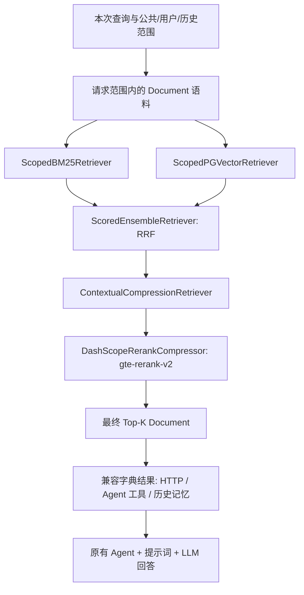

# LangChain 混合检索

公共知识库、个人知识库和双层记忆中的历史 RAG 共用 LangChain 检索链路。原来的 HTTP 接口、MCP/本地工具和单/多 Agent 调用无需改参数。取到资料后，仍由原有 Agent 的提示词、工具循环和 LangChain 对话模型生成回答；检索工具本身不会额外调用一次回答模型。



## 组件与文件

| 阶段 | LangChain 组件 | 项目适配 |
| --- | --- | --- |
| 统一资料对象 | `langchain_core.documents.Document` | 正文在 `page_content`；ID、标题、来源及各路分数在 `metadata` |
| BM25 | `langchain_community.retrievers.BM25Retriever` | `ScopedBM25Retriever` + `rank_bm25.BM25Okapi`，保留 jieba、标题索引、正 IDF 和零匹配过滤 |
| pgvector | `langchain_core.retrievers.BaseRetriever` | `ScopedPGVectorRetriever` 在现有 SQLAlchemy 表上执行余弦距离 SQL |
| RRF | `langchain_classic.retrievers.EnsembleRetriever` | `ScoredEnsembleRetriever` 调用原生融合方法，补齐原始分数和旧接口的同分顺序 |
| reranker | `ContextualCompressionRetriever` + `BaseDocumentCompressor` | `DashScopeRerankCompressor` 复用现有百炼 `gte-rerank-v2` 客户端与错误回退 |

组件与建链入口在 `backend/app/services/langchain_retrieval.py`。`hybrid_retrieval.py` 保留原 `search_hybrid`、BM25/RRF 辅助函数及分数字典接口；不再维护另一套手写召回/融合算法。`rerank_client.py` 保留实际百炼 HTTP 请求、索引/分数校验及故障回退。

公共入口是 `rag_service.search`，个人入口是 `user_knowledge_service.search`，历史入口是 `memory_service.search_history`，它们仍调用 `search_hybrid`，因此一起使用新流程。偏好/事实 JSON 卡片和短期摘要不是此检索链的一部分。

## 保留的规则

- 1024 维智谱 `embedding-3` 和现有 `knowledge_chunks`、`user_knowledge`、`memory_episodes` 表继续使用。没有换成 `langchain-postgres.PGVector` 自动创建的 collection 表，避免迁移业务外键、用户隔离和已有向量。pgvector 是项目自定义的标准 Retriever 适配。
- 先读取限定范围的语料，再由原生 Ensemble 异步并行调度 BM25 与 Dense。BM25 在线程池运行，不访问 SQL 会话；只有 Dense 执行第二次 SQL，避免同一个 `AsyncSession` 并发查询。
- 私有 BM25 文档频率、Dense SQL 和发往 reranker 的候选都来自同一用户；历史检索的消息排除名单作用于两路。
- Ensemble 使用 `id_key="id"`，避免把正文相同但 ID 不同的片段错误合并。每路先去重，排名从 1 开始。
- 权重为 `[1, 1]`、常数为 `RAG_RRF_K`，保持原来的 `Σ 1 / (k + rank)` 分数。原生 Ensemble 排序后补齐分数元数据；只调整同分组的 BM25 排名/主键顺序。
- RRF 候选先按 `max(top_k, RERANK_CANDIDATE_K)` 截取，再重排，最后取 Top-K。Compressor 在这里做重排序，不摘要或删改片段正文。
- 未启用/无 Key/排序 API 故障时保留 RRF 排名，排序分数为 null；空库不调用 Embedding 或 rerank。已有查询零向量与非法向量保护继续生效。
- 每个请求构建独立 Retriever，不跨请求缓存语料；一次调用完成后丢弃，新增/删除在下次请求可见。不要复用已绑定数据库会话的实例，也不要并发调用同一个实例。

## 安装与调用

```powershell
cd backend
.\.venv\Scripts\python.exe -m pip install -r requirements.txt
```

新增 `langchain-classic`、`langchain-community` 和 `rank-bm25` 依赖；`langchain-core` 最低版本对应这些组件。这里使用发行包实际提供的导入路径：Ensemble/Compression 位于 `langchain-classic`，BM25 位于 `langchain-community`，不是旧教程中的 `langchain.retrievers`。重启后端及正在运行的 worker/MCP 服务即可，不增加 Key、不改 `.env`、不要求数据库迁移或重建向量。

已有调用仍是 `await search_hybrid(db, query, top_k, user_id=...)`。需要直接组合 LangChain 时可使用：

```python
from app.services.langchain_retrieval import build_hybrid_retriever
from app.services.embedding_client import embedding_client
from app.services.rerank_client import rerank_client

# db 必须在整个 ainvoke 期间保持打开。
retriever = await build_hybrid_retriever(
    db, 5, embedder=embedding_client, reranker=rerank_client, user_id=current_user.id,
)
documents = await retriever.ainvoke(query)
```

数据库 Retriever 和 rerank compressor 都采用异步调用，不能用同步 `invoke` 隐式创建事件循环。LangChain 原生 callbacks/config 会传播到两路 Retriever；百炼 compressor 的 HTTP 调用由现有客户端负责，不产生独立的 LangChain LLM 事件。

如果需要独立于 Agent 的标准资料问答，返回的 Retriever 可以直接传给 `create_retrieval_chain` 和 `create_stuff_documents_chain`，结果含 `answer` 与原始 `context`。真实验收脚本演示了该组合，但现有聊天入口继续使用自己的 Agent 工作流，没有新增 `/ask` 接口。

## 验证

```powershell
.\.venv\Scripts\python.exe -m pytest tests/unit/test_langchain_retrieval.py tests/unit/test_hybrid_retrieval.py tests/unit/test_rerank_client.py tests/api/test_langchain_knowledge.py tests/api/test_hybrid_knowledge.py tests/api/test_rerank_knowledge.py tests/api/test_memory.py -o addopts= -q
.\.venv\Scripts\python.exe -m app.scripts.verify_langchain_rag --output ../docs/LANGCHAIN_RAG_LIVE_2026-10-11.json
```

回归使用真实 PostgreSQL 与模型替身。新用例额外证明调用原生 Ensemble、两路并行、callbacks 传播、Document 保留和原生问答链组合。真实脚本使用开发库与已配置付费模型，检查公共/个人 API、用户隔离、历史排除和标准 RAG 问答链；只创建临时合成账号与资料，结束后级联清理。报告已有时拒绝覆盖，模型回退警告会使验收失败。详细实际结果见 `LANGCHAIN_RAG_VALIDATION_2026-10-11.md`。

框架迁移不会增加资料来源，也不能保证模型更准确；BM25 仍全量读取范围内的文本，适合当前较小语料。

参考：[LangChain EnsembleRetriever](https://reference.langchain.com/python/langchain-classic/retrievers/ensemble/EnsembleRetriever)、[原生 Retrieval Chain](https://github.com/langchain-ai/langchain/blob/master/libs/langchain/langchain_classic/chains/retrieval.py)。
