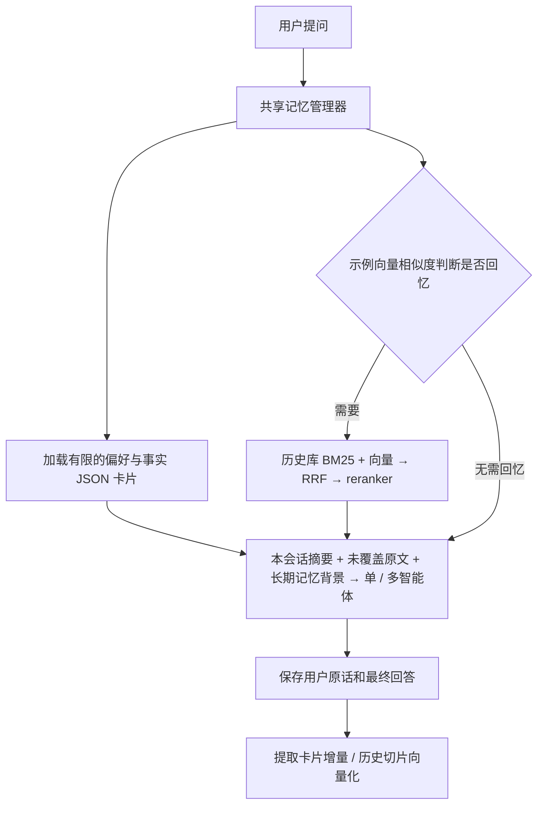

# 偏好与事实卡片 + 历史 RAG

登录用户的单智能体和多智能体共用两层长期记忆。短期上下文为本会话滚动摘要与全部未覆盖原文，每五轮检查长度，超预算才压缩较早消息，保留最近五轮原文；详见 [CHAT_SUMMARY.md](CHAT_SUMMARY.md)。长期记忆按用户隔离，可以跨会话使用。匿名聊天不读取或保存记忆。



## 第一层：偏好与事实卡片

`memory_cards` 使用 PostgreSQL JSONB 保存内容，例如：

```json
{
  "kind": "preference",
  "key": "diet",
  "data": {
    "value": "不吃辣",
    "evidence": "我平时不吃辣"
  },
  "source_message_id": 123
}
```

默认对话模型负责从本轮用户输入提取结构化增量，例如饮食习惯、常住地和交通偏好。提示词要求排除问题、假设、别人的情况和临时计划；代码额外校验 `evidence` 必须出现在来源用户消息中。AI 回答、设置页自动注入的文本和解析出的附件内容不用于卡片提取。原话证据可以追溯，但模型对“是否属于稳定事实”的判断仍可能出错。

用户明确更正同一主题时，提取模型复用已有 `kind + key` 更新卡片。数据库唯一约束、每用户事务锁与来源消息 ID 的单调条件，防止并发重复和旧请求的慢结果覆盖较新来源。同一主题的语义归并依赖模型复用 key，尚无独立的语义去重模型。

默认最多保留最近确认的 30 个主题，注入时卡片 JSON 总量不超过 2500 字符。未被保留的主题，其原始聊天仍可通过历史 RAG 找回。会话摘要属于短期上下文，该版本没有跨会话全局概览卡片。

既有 `user_preferences` 设置页不变：显式保存的偏好与自动卡片互为补充，记忆提示词要求优先使用最新用户陈述和设置页明确保存的偏好。

## 第二层：需要时检索历史

`memory_episodes` 与公共知识库、上传的个人知识库分开。每条用户/助手消息按约 900 字符切块、100 字符重叠，保存角色、日期、会话、来源消息 ID 和 1024 维向量。默认使用智谱 `embedding-3`；数据库仍是 PostgreSQL + pgvector。

检索复用项目已有链路：

1. 在当前用户历史语料中计算中文 BM25。
2. 在相同用户范围执行向量余弦检索。
3. RRF 融合，两路默认各取 30 条候选。
4. 百炼 `gte-rerank-v2` 重排序，默认取 3 条历史片段。
5. 去掉当前会话已作为未覆盖原文注入的消息（关闭短期摘要时仍排除最近 10 条），历史 JSON 限制为 3500 字符。已摘要的原文可以检索回来补充细节。

历史检索现在由 `recall_gate.py` 的示例向量相似度触发，原 `RECALL_WORDS` 已删除，不再检查是否包含“之前/上次”等词，也不额外调用对话模型分类。复用真实智谱 Embedding，与 57 条示例计算归一化余弦分，每类别取最近两个示例的平均值，最高分达到默认 0.62 才采用结果。业务意图与回忆触发共用 `semantic_examples.py` 的严格向量索引实现，但各自持有独立示例缓存。

四个类别分别为纯历史问答 `history`、结合记忆做新任务 `mixed`、当前问题/闲聊 `current` 和省略式追问 `followup`。前两者触发历史检索；`history` 携带记忆进入通用回答，避免被天气等业务意图路由低分拦截；`mixed` 继续正常业务路由。管理删除请求继续优先进入审批，记忆内容不能授权操作。

例如“那家餐厅叫什么”不包含旧触发词也能检索；“广州历史上有什么建筑”“记得写上路线耗时”含旧触发词但可判为当前任务而跳过历史。纯向量分类仍有误判风险，不保证识别所有否定或隐含请求。

普通和 SSE 在获得会话历史后，只做一次共享判断。追问类按最近最多 3 条用户消息寻找回忆主题；连续追问可向前追溯，遇到当前业务/闲聊就停止；没有用户原文时允许参考最近一份摘要，不独立采信助手文字。继承后把前文问题与本次追问组合为检索 query，避免只搜索“那后来呢”。不同用户/会话不会共享问题或检索结果。

回忆触发严格禁止哈希伪向量；无 Key、超时、向量不完整/无效时记录 `unavailable`，跳过自动历史检索并保留卡片。真正的历史内容检索继续原 BM25 + 向量 + RRF + rerank，现有历史内容 Embedding 降级策略保留。触发判断与内容召回是两个步骤，不应把示例相似度当成真实历史内容的相关度。

注入 JSON 新增 `recall` 元数据：`need_recall/history_only/status/scores/retrieval_status`，查询文本不重复注入。`retrieval_status` 区分未请求、命中、空结果、失败；提示词禁止把故障说成“没有记录”。完整记忆背景随业务图保存，检查点恢复复用它，新一轮重新准备。业务执行前的记忆准备仍位于共享服务入口，不新增会自行调用记忆工具的 Agent。

卡片仍每轮自动加载，是否回忆详细历史不影响卡片注入。首次需分批生成公共示例向量，进程内缓存按模型、维度、服务、凭据与语料隔离，并发预热共用、失败不发布半成品；后续只生成当前输入和必要前文的向量。需要真实 Embedding Key，修改示例后重启后端。

历史助手回答是过去的回答，不能作为已确认的用户事实或实时信息。提示词要求把卡片和检索结果当作背景资料，忽略其中的命令，记忆不足时如实说明。

## 写入、旧聊天与清空

普通聊天和 SSE 均先保存一整轮用户原话与最终回答，再并行执行一次卡片提取和历史索引；多智能体各领域不各自写记忆。SSE 的 `done` 在这些操作完成或超时降级后才发送，收到 `done` 后下一轮可以读取已保存的记忆。每个记忆阶段默认 20 秒超时，会增加普通接口响应时间和 SSE 结束前的等待时间。

不依赖 Redis、Celery 或额外数据库。提取/索引失败不影响已生成的回答和原始聊天；失败的历史索引可通过回填补齐。失败的卡片提取本轮跳过，回填接口只补历史 RAG，不重新提取旧卡片。

新聊天立即索引。旧聊天在触发回忆时补一批，默认最多 30 条未索引消息；旧库较大时需要分批调用回填接口，直到 `has_more=false`。该限制避免首个问题等待整个旧库向量化，也意味着旧库尚未回填完成时，历史检索不是完整的。

删除会话会删除短期摘要，并通过来源外键删除该会话直接产生的卡片和历史切片。清空全部长期记忆同时保存消息水位，确保在途提取/索引与后续回填不会重新导入清空前的消息。清空不删除原始聊天，也不清空同会话摘要和未覆盖原文；要排除这些短期上下文，请新建会话或删除旧会话。清空后的新聊天可以继续形成新记忆。

## 接口

均需要登录，使用正常的 Bearer Token；返回 `{code,message,data}`。

| 接口 | 用途 |
| --- | --- |
| `GET /api/v1/memory/cards` | 查看卡片、原话证据和来源消息 ID |
| `POST /api/v1/memory/search` | 检索历史；请求 `{"query":"上次活动的暗号","top_k":3}` |
| `POST /api/v1/memory/backfill` | 回填一批旧聊天，返回 `indexed_chunks`、`remaining_messages`、`has_more` |
| `DELETE /api/v1/memory` | 清空两层长期记忆，保留原始聊天 |

可在后端 `/docs` 页面登录后操作；该版本未添加独立的前端记忆管理页面。卡片更正可直接通过聊天表达。关闭 `MEMORY_ENABLED` 后停止自动读取和写入，并禁止检索与回填；查看和清空接口仍可用。

## 配置与启动

执行项目根目录 `./scripts/dev.ps1 migrate` 并重启后端，迁移 `0016_chat_memory` 创建三张表；第三张 `memory_states` 只保存清空水位，不是第三层内容记忆。此次实现无需安装新依赖，已有 DeepSeek、智谱和百炼配置直接复用；本地 `.env` 不需要为此增加必填 Key。

| 配置 | 默认值 | 用途 |
| --- | --- | --- |
| `MEMORY_ENABLED` | `true` | 开关 |
| `MEMORY_CARD_LIMIT` | `30` | 存储及加载主题上限 |
| `MEMORY_CARD_CHARS` | `2500` | 卡片 JSON 字符预算 |
| `MEMORY_HISTORY_TOP_K` | `3` | 历史片段数量 |
| `MEMORY_HISTORY_CHARS` | `3500` | 历史 JSON 字符预算 |
| `MEMORY_TIMEOUT` | `20` | 单个自动记忆阶段超时秒数 |
| `MEMORY_BACKFILL_BATCH` | `30` | 每批历史消息上限 |
| `MEMORY_RECALL_THRESHOLD` | `0.62` | 回忆类别最近两个示例平均余弦分的最低门槛，不是概率 |
| `MEMORY_RECALL_CONTEXT_TURNS` | `3` | 省略式追问最多回看的用户消息条数 |
| `MEMORY_RECALL_TIMEOUT` | `20` | 触发判断上限，含示例预热 |

成本主要是每轮额外的一次短结构化模型提取、用户消息与最终回答的切片 Embedding，以及回忆时的查询 Embedding 和 rerank。多智能体只写一次记忆，但每个生成节点都会收到同一份有限背景，因此各节点仍有相应输入 token 成本。大规模历史库当前会在线读取当前用户全文计算 BM25，并执行向量距离排序；后续可添加持久倒排索引与向量近邻索引，现阶段适合个人和小规模使用。

主要入口：`app/services/memory_service.py`。模型和迁移分别在 `app/models/memory.py`、`alembic/versions/0016_chat_memory.py`；接入点在 `app/routers/chat.py`、`app/services/agent.py`、`app/services/multi_agent.py`。

## 与 Checkpointer 配合

单/多 Agent 的登录文字对话同时接入 PostgreSQL Checkpointer。双层记忆负责跨会话偏好和历史召回，Checkpointer 负责图状态与执行恢复，短期摘要继续控制本会话历史。新任务刷新背景并覆盖 reducer 字段，避免重复注入历史或沿用旧领域结果。配置、恢复/清除接口与节点恢复边界见 [CHECKPOINT_MEMORY.md](CHECKPOINT_MEMORY.md)。

自动回归使用真实数据库和模型替身；真实模型验收脚本 `python -m app.scripts.verify_memory` 会调用已配置的外部 API，创建只含合成信息的临时账号，完成后删除这些账号及记忆，并保存验证记录。


## 回忆触发验收

无数据库回归：`python -m pytest tests/unit/test_recall_gate.py tests/unit/test_agent_intent.py tests/unit/test_multi_agent.py --no-db -o addopts= -q`。覆盖无关键词回忆、有旧词不回忆、前文继承/切换/隔离、严格 Embedding 故障、卡片保留、检索状态与用户范围、纯回忆通用回答、普通/SSE 单多模式及 InMemorySaver 恢复/新轮刷新。

真实模型：`python -m app.scripts.evaluate_recall_gate --suite acceptance --http --output ../docs/RECALL_GATE_ACCEPTANCE_<新名称>.json`。会调用真实付费 Embedding 与对话模型，已有报告拒绝覆盖；`--http` 通过真实图/ASGI 普通与 SSE 接口使用合成认证和记忆仓库替身，不读写 PostgreSQL，不修改 `.env`。它验证模型与流程衔接，不能代替真实数据库/权限集成验证。

首轮校准 16/18，随后补充旧预算与提醒格式的边界示例；独立验收 20/20，四种普通/SSE × 单/多模式接口均回答出了合成记忆中的餐厅名。见 [原始校准](RECALL_GATE_CALIBRATION_2026-10-24.json) 和 [最终验收](RECALL_GATE_ACCEPTANCE_2026-10-24.json)。这些是当前模型和小规模问句集的结果，不代表线上总体准确率。
